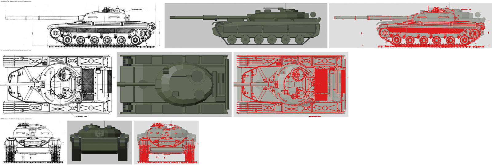
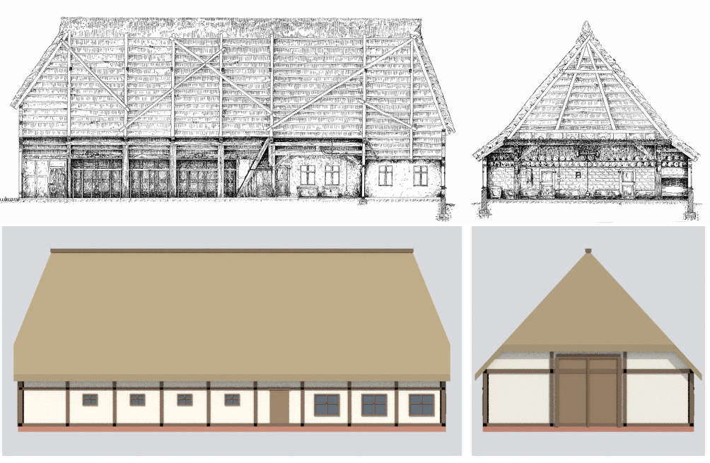
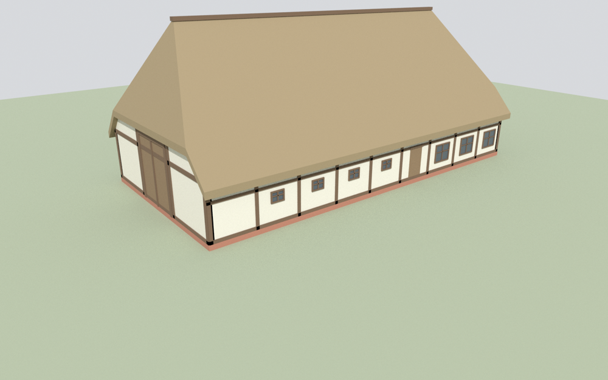

# Rainbow Codes: Drawing-to-Model Asset Workflow

Low-poly, game-ready 3D models built **entirely from Python scripts in Blender**, measured off a reference drawing and checked against it. No sculpting, no hand-modelling, no paid AI mesh services.

This is the method used to build the vehicles and buildings for *Rainbow Codes*, a Cold War armoured-warfare game (1980, BAOR vs Warsaw Pact) made in Godot. Two complete worked examples are included:

| Example | Source drawing | Result |
|---|---|---|
| **T-64 main battle tank** | Object 432 three-view, 91.1 px/m | 8.68 m long with gun, 4,768 triangles, turret and gun as separate moving parts |
| **Niedersachsenhaus** (Lower Saxon hall house) | Long and cross section, 24.7 px/m | 24.4 × 12.0 m, 10.4 m to ridge, about 2,100 triangles |







## The method in one paragraph

Work out the drawing's scale in pixels per metre. Read every dimension off the drawing with a pixel grid. Pick one origin point (ground level, under the turret ring or in the middle of the footprint). Write a script that builds the object out of simple shapes (boxes, extruded profiles, cylinders, lofts) at those exact metre positions. Render flat views at the drawing's scale and lay them over the drawing. Fix whatever doesn't line up, re-run, and export a `.glb` for the game. The full step-by-step version is in [WORKFLOW.txt](WORKFLOW.txt).

## What's in here

```
shared_kit/
  rc_vehicle_kit.py     shape and material functions shared by every vehicle
  grid.py               puts a labelled pixel grid on a drawing so you can measure it
  check_views.py        renders flat views and builds the reference | render | overlay sheet
vehicles/t64/
  build_t64_v001.py     the T-64 build script (all measurements live here)
  t64_check.json        which part of the drawing is which view, and its scale
  refs/t64.png          reference drawing
  RC_T64_v001.glb       game model    RC_T64_v001.blend   Blender file
  RC_T64_v001_check.png check sheet
buildings/niedersachsenhaus/
  build_house.py        builds, renders checks and exports the house in one go
  refs/Schnitt_Niedersachsenhaus.png
  niedersachsenhaus.glb / .blend / check_vs_drawing.png
```

## Requirements

- **Blender 5.1** (any 4.x or 5.x should work)
- **Pillow** for `grid.py` and `check_views.py`

Blender ships its own Python without Pillow, so install it into Blender once:

```powershell
& "C:\Program Files\Blender Foundation\Blender 5.1\blender.exe" --background --python-expr "import subprocess, sys; subprocess.check_call([sys.executable, '-m', 'pip', 'install', 'pillow'])"
```

Alternatively, with Python 3.13 you can `pip install bpy==5.1.2 pillow` and run every script with plain `python` instead of `blender.exe`.

## Running it (Windows PowerShell, from the repo folder)

The `&` at the front is required in PowerShell because the Blender path contains spaces.

```powershell
$blender = "C:\Program Files\Blender Foundation\Blender 5.1\blender.exe"

# T-64: build, then check against the drawing
& $blender --background --python vehicles\t64\build_t64_v001.py
& $blender --background --python shared_kit\check_views.py -- vehicles\t64\t64_check.json

# House: builds, renders checks and exports in one step
& $blender --background --python buildings\niedersachsenhaus\build_house.py
```

On Linux or macOS, drop the `&` and use `blender` or the full path.

Every script writes its output next to itself. Change a number in a build script, re-run it, and you get a new model plus fresh check images in seconds.

## Conventions

- **1 Blender unit = 1 metre**, so models import into Godot at true scale.
- **Vehicles:** +Y forward, +X right, +Z up. The origin is on the ground under the turret ring. The hierarchy is `ROOT > Hull, Turret > Gun > Muzzle`, so the turret traverses and the gun elevates in the game. Godot receives Blender +Y as -Z.
- **Buildings:** the long axis is X and the origin is ground level at the centre of the footprint. The house is split into one mesh per material (walls, footing, timber, roof, doors, windows) to keep draw calls low.
- **Low detail on purpose:** flat shading and plain colours, about 2–6k triangles per asset. This is the late-90s simulator look the game is aiming for.

## Using the models in Godot

Copy the `.glb` into your project, for example `res://assets/vehicles/t64/`. Godot imports it at 1:1 scale. For vehicles, rotate the `Turret` node for traverse and the `Gun` node around its local X axis for elevation, and read the `Muzzle` node's global position for the shot origin.

## Reference drawings

The drawings in `refs/` belong to their original sources and are included only so the check images can be reproduced. If you build your own assets, use drawings you have the rights to.
